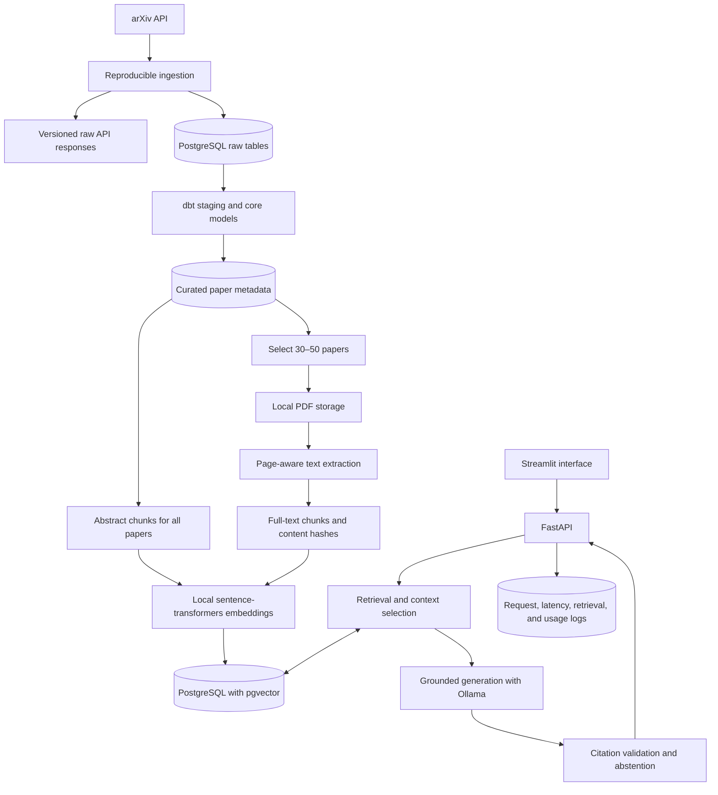

# Research Evidence Copilot

Research Evidence Copilot is a evidence-grounded research assistant for retrieval-augmented generation (RAG) literature. It searches a deliberately limited collection of papers and answers questions using only retrieved evidence. Every substantial claim must point back to an indexed abstract or a page-level passage from a paper.

This is a prototype project, not a production launch or a general-purpose chatbot. The project combines data engineering practices—reproducible ingestion, raw-data preservation, data modeling, testing, lineage, and observability—with AI engineering practices such as document extraction, chunking, embeddings, retrieval, grounded generation, citation validation, abstention, and evaluation.

## Target user and problem

The primary users are AI engineers, graduate students, and applied researchers who need to follow RAG research but do not have time to discover, read, and compare every new paper. Keyword search can locate papers, but it does not reliably synthesize findings, expose conflicting evidence, or show precisely where a claim came from.

The proposed solution indexes a focused arXiv collection and provides semantic paper discovery and evidence-based answers. It presents supporting passages, paper metadata, page or abstract citations, and links to the original papers. When the indexed collection does not contain adequate evidence, the system should say so rather than fill the gap with model knowledge.

## Scope

The MVP is limited to arXiv papers published from 2020 onward in `cs.CL` and `cs.IR` that concern:

- Retrieval-augmented generation
- Sparse, dense, and hybrid retrieval for RAG
- RAG evaluation
- Hallucination and faithfulness in RAG systems

Approximately 300 paper records will be collected. Abstracts will be indexed for all collected papers, while approximately 30–50 relevant and appropriately licensed papers will receive full-text processing.

The MVP uses arXiv as its only external research source. It does not use Hugging Face, Papers With Code, GitHub, GCP, Spark, Airflow, Grafana, Tableau, multiple LLM providers, or autonomous agents.

## Success criteria

The prototype is successful when it can:

- Retrieve relevant papers and passages for the representative questions below.
- Generate concise answers using only retrieved evidence.
- Attach a valid arXiv ID and page number, or `abstract`, to every factual citation.
- Link every cited result to its original arXiv source.
- Reject citations that do not correspond to retrieved evidence.
- Abstain transparently when a question is outside the collection or retrieval evidence is weak.
- Report retrieval quality, citation validity, abstention accuracy, latency, and available model-usage metrics.
- Reproduce ingestion, transformation, and indexing without creating duplicate records or chunks.

## Representative questions

These ten questions form the initial functional and evaluation targets:

1. Which papers compare dense retrieval with hybrid retrieval for RAG?
2. What are the most relevant RAG evaluation papers published since 2023?
3. Which papers study retrieval methods for multimodal RAG?
4. Which indexed papers are most similar to a supplied abstract about evaluating RAG faithfulness?
5. Does hybrid retrieval generally outperform dense retrieval, and under what experimental conditions?
6. How do RAGAS and ARES evaluate faithfulness, and how do their approaches differ?
7. Which datasets and metrics are used to evaluate retrieval quality in the most relevant indexed RAG evaluation papers?
8. What methodology, datasets, and limitations are reported in the indexed RAGAS paper?
9. What limitations recur across papers about RAG evaluation?
10. Which indexed papers report mixed or conflicting findings about the value of reranking?

## Questions the system must refuse or qualify

The following examples test the system's abstention behavior:

1. **Outside the research domain:** "Who won the 2026 FIFA World Cup?"
2. **Unsupported prediction:** "What accuracy would a cached RAG system achieve on a dataset that has not been tested?"
3. **Requires executing research code:** "Run this paper's repository and reproduce its reported results."
4. **Not yet indexed:** "Summarize this RAG paper that was published an hour ago but has not entered the collection."
5. **Claims unjustified scientific certainty:** "Which claim about RAG evaluation is unquestionably true?"

Questions must also be qualified when only abstracts are available but the requested answer requires detailed methods, results, tables, or limitations.

## Evidence contract

Every substantial answer follows this structure:

```text
Short answer
Key findings
Supporting evidence
Conflicting or mixed evidence
Limitations
Confidence
Sources
```

A citation uses `[arXiv:<id>, p.<page>]` for full-text evidence or `[arXiv:<id>, abstract]` for abstract-only evidence. Confidence describes evidence coverage and consistency; it is not a probability that a scientific claim is true.

## Local MVP architecture



Raw API responses and downloaded PDFs remain local and are not committed to Git. Raw responses are versioned by ingestion run so every transformed record can be traced to its source.

## Technology

| Layer | Technology |
|---|---|
| Language | Python |
| Database | PostgreSQL with pgvector |
| Raw storage | Local versioned files |
| Transformation | dbt Core with PostgreSQL |
| Embeddings | Local sentence-transformers model |
| Generation | Ollama |
| API | FastAPI |
| Interface | Streamlit |
| Testing | pytest and dbt tests |
| Environment | Docker Compose, uv, and Git |

## Local setup

### Prerequisites

- Git
- Python matching `.python-version`
- [uv](https://docs.astral.sh/uv/)
- Docker with Docker Compose
- Ollama, required later for local answer generation

### Install and start the database

```bash
git clone <repository-url>
cd research-evidence-copilot
cp .env.example .env
uv sync --locked
docker compose up -d
```

Confirm that PostgreSQL accepts connections:

```bash
docker compose exec postgres sh -c 'psql -U "$POSTGRES_USER" -d "$POSTGRES_DB" -c "SELECT version();"'
```

Database extension initialization and an automated health check are still required before Day 1 is complete.

## Known MVP limitations

- Coverage is deliberately restricted to a reproducible arXiv search rather than all AI research.
- Most papers have abstract-only evidence; only a selected subset receives page-level indexing.
- PDF extraction can lose tables, equations, columns, or section structure.
- Similarity retrieval does not prove that two studies are directly comparable.
- The model may summarize conflicting evidence but cannot determine scientific truth.
- Citation validation checks provenance against retrieved chunks; it does not independently reproduce a paper's experiments.
- Local model quality and latency depend on the user's hardware and installed Ollama model.

## Project status

The repository is currently completing Day 1: definition and environment preparation. The architecture above describes the intended seven-day MVP; features should not be interpreted as implemented until their corresponding code and tests are present.
