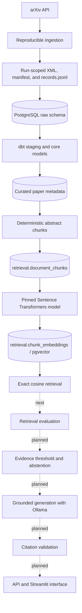

# Research Evidence Copilot

Research Evidence Copilot is an evidence-grounded research assistant for
retrieval-augmented generation (RAG) literature. It builds a reproducible local
collection of arXiv papers, transforms the records into tested analytical
models, creates traceable evidence chunks, embeds them locally, and retrieves
the most relevant evidence with PostgreSQL and pgvector.

This repository is a learning-oriented prototype rather than a production
launch or a general-purpose chatbot. It deliberately combines data engineering
practices—reproducible ingestion, raw-data preservation, data contracts,
modeling, lineage, and testing—with AI engineering practices such as
deterministic chunking, embeddings, semantic retrieval, evaluation, grounded
generation, citation validation, and abstention.

## Current status

The pipeline currently works through exact semantic retrieval:

```text
arXiv ingestion
    → run-scoped raw files
    → PostgreSQL raw tables
    → dbt staging and core models
    → deterministic abstract chunks
    → local Sentence Transformers embeddings
    → PostgreSQL pgvector storage
    → exact cosine-similarity retrieval
```

Implemented and tested:

- Reproducible full and incremental arXiv ingestion with immutable raw pages,
  run manifests, run-scoped JSONL records, and canonical deduplication.
- Idempotent loading into PostgreSQL raw tables.
- dbt staging and core models for papers, paper versions, authors, categories,
  relationships, and ingestion-run history.
- Data-quality, uniqueness, relationship, lineage, and business-rule tests.
- Deterministic abstract chunking with stable content hashes and chunk IDs.
- Idempotent persistence of chunks in `retrieval.document_chunks`.
- Local embeddings with the pinned
  `sentence-transformers/all-MiniLM-L6-v2` model revision.
- Revision-aware embedding storage in `retrieval.chunk_embeddings`.
- Operational CLIs for chunk and embedding loads.
- Exact semantic retrieval with model-revision filtering, deterministic
  ranking, and citation-ready evidence metadata.

The next checkpoint is retrieval evaluation using a manually reviewed query
set and Hit Rate@5, Recall@5, and MRR@5. Answer generation has not been added
yet.

## Target user and problem

The primary users are AI engineers, graduate students, and applied researchers
who need to follow RAG research but do not have time to discover, read, and
compare every new paper. Keyword search can locate papers, but it does not
reliably synthesize findings, expose conflicting evidence, or show precisely
where a claim came from.

The proposed product indexes a focused arXiv collection and provides semantic
paper discovery and evidence-based answers. It should present supporting
passages, paper metadata, abstract or page citations, and links to the original
papers. When the indexed collection does not contain adequate evidence, the
system should say so rather than fill the gap with model knowledge.

## Scope

The MVP targets arXiv papers published from 2020 onward in `cs.CL` and `cs.IR`
that concern:

- Retrieval-augmented generation
- Sparse, dense, and hybrid retrieval for RAG
- RAG evaluation
- Hallucination and faithfulness in RAG systems

The ingestion target is approximately 300 paper records. The implemented
retrieval corpus currently uses one normalized abstract chunk per eligible
paper. Page-aware PDF extraction and full-text chunks for a smaller licensed
subset remain planned work.

arXiv is the only external research source in the MVP. The project does not
depend on GCP, Spark, Airflow, multiple LLM providers, or autonomous agents.

## Success criteria

The prototype is successful when it can:

- Retrieve relevant papers and passages for representative research questions.
- Measure retrieval quality before connecting retrieval to generation.
- Generate concise answers using only retrieved evidence.
- Attach a valid arXiv ID and page number, or `abstract`, to every factual
  citation.
- Link every cited result to its original arXiv source.
- Reject citations that do not correspond to retrieved evidence.
- Abstain transparently when a question is outside the collection or retrieval
  evidence is weak.
- Report retrieval quality, citation validity, abstention accuracy, latency,
  and available model-usage metrics.
- Reproduce ingestion, transformation, chunking, and embedding without creating
  duplicate records.

## Representative questions

These questions provide initial functional and evaluation targets:

1. Which papers compare dense retrieval with hybrid retrieval for RAG?
2. What are the most relevant RAG evaluation papers published since 2023?
3. Which papers study retrieval methods for multimodal RAG?
4. Which indexed papers are most similar to a supplied abstract about
   evaluating RAG faithfulness?
5. Does hybrid retrieval generally outperform dense retrieval, and under what
   experimental conditions?
6. How do RAGAS and ARES evaluate faithfulness, and how do their approaches
   differ?
7. Which datasets and metrics are used to evaluate retrieval quality in the
   most relevant indexed RAG evaluation papers?
8. What methodology, datasets, and limitations are reported in the indexed
   RAGAS paper?
9. What limitations recur across papers about RAG evaluation?
10. Which indexed papers report mixed or conflicting findings about the value
    of reranking?

## Questions the system must refuse or qualify

The following examples are future abstention targets:

1. **Outside the research domain:** “Who won the 2026 FIFA World Cup?”
2. **Unsupported prediction:** “What accuracy would a cached RAG system achieve
   on a dataset that has not been tested?”
3. **Requires executing research code:** “Run this paper's repository and
   reproduce its reported results.”
4. **Not indexed:** “Summarize a paper that has not entered the collection.”
5. **Unjustified scientific certainty:** “Which claim about RAG evaluation is
   unquestionably true?”

Questions must also be qualified when only abstracts are available but the
requested answer requires detailed methods, results, tables, or limitations.

## Evidence contract

The planned answer layer follows this structure:

```text
Short answer
Key findings
Supporting evidence
Conflicting or mixed evidence
Limitations
Confidence
Sources
```

A citation will use `[arXiv:<id>, p.<page>]` for full-text evidence or
`[arXiv:<id>, abstract]` for abstract-only evidence. Confidence will describe
evidence coverage and consistency; it will not represent the probability that
a scientific claim is true.

## Architecture



Raw API responses remain local and are not committed to Git. Each ingestion run
has its own immutable source files so a transformed paper can be traced back to
the run, file, and source line that produced it.

## Technology

| Layer | Technology | Status |
|---|---|---|
| Language and environment | Python 3.13, uv | Implemented |
| Database | PostgreSQL 17 with pgvector | Implemented |
| Raw storage | Local run-scoped files | Implemented |
| Transformation | dbt Core with PostgreSQL | Implemented |
| Embeddings | Sentence Transformers, local execution | Implemented |
| Retrieval | Exact pgvector cosine search | Implemented |
| Evaluation | JSONL relevance set and retrieval metrics | Next |
| Generation | Ollama | Planned |
| API and interface | FastAPI and Streamlit | Planned |
| Testing | pytest and dbt tests | Implemented |
| Local services | Docker Compose | Implemented |

## Data model

The PostgreSQL database is separated by responsibility:

| Schema | Relation | Purpose |
|---|---|---|
| `raw` | `ingestion_runs` | Ingestion configuration, status, counts, and lineage |
| `raw` | `arxiv_paper_observations` | Run-specific paper-version observations and raw records |
| `dbt_dev` | staging models | Typed, cleaned interfaces over raw data |
| `dbt_dev` | core models | Papers, versions, authors, categories, and relationships |
| `retrieval` | `document_chunks` | Stable evidence chunks and citation metadata |
| `retrieval` | `chunk_embeddings` | Model-revision-specific pgvector embeddings |

Detailed contracts and documentation are available in:

- [`docs/raw-data-contract.md`](docs/raw-data-contract.md)
- [`docs/data-dictionary.md`](docs/data-dictionary.md)
- [`docs/data-quality-validation.md`](docs/data-quality-validation.md)
- [`docs/chunk-data-contract.md`](docs/chunk-data-contract.md)
- [`docs/embedding-data-contract.md`](docs/embedding-data-contract.md)
- [`docs/retrieval-contract.md`](docs/retrieval-contract.md)

## Local setup

### Prerequisites

- Git
- Python matching `.python-version`
- [uv](https://docs.astral.sh/uv/)
- Docker with Docker Compose
- Ollama only when the later generation phase begins

### Install and start PostgreSQL

```bash
git clone <repository-url>
cd research-evidence-copilot
cp .env.example .env
uv sync --locked
docker compose up -d
```

Set the local database credentials and `DBT_SCHEMA=dbt_dev` in `.env`.

Apply the SQL files in order using `psql` or another PostgreSQL client:

```bash
psql -h localhost -U <DB_USER> -d <DB_NAME> -f sql/001_create_raw_tables.sql
psql -h localhost -U <DB_USER> -d <DB_NAME> -f sql/002_create_retrieval_tables.sql
psql -h localhost -U <DB_USER> -d <DB_NAME> -f sql/003_create_embedding_tables.sql
```

Confirm the dbt connection:

```bash
uv run dbt debug --project-dir transformations --profiles-dir transformations
```

## Run the pipeline

### 1. Ingest arXiv records

Run a reproducible full load with an explicit cutoff:

```bash
uv run ingest-arxiv full \
  --start 2020-01-01 \
  --cutoff 2026-07-22 \
  --target 300 \
  --user-agent "research-evidence-copilot/0.1 (contact: you@example.com)"
```

Each run writes immutable Atom XML pages, `manifest.json`, and `records.jsonl`
under `data/raw/arxiv/<run-id>/`. The successful run also publishes the
deduplicated canonical collection to `data/processed/arxiv_papers.jsonl`.
Duplicate query hits are identified by `(arxiv_id, version)`; distinct paper
versions remain separate records.

For a later submitted-date window, use incremental mode:

```bash
uv run ingest-arxiv incremental \
  --start 2026-07-22 \
  --cutoff 2026-07-23 \
  --target 300 \
  --user-agent "research-evidence-copilot/0.1 (contact: you@example.com)"
```

### 2. Load raw data and build dbt models

The Python raw-data loader validates a successful run's manifest and
run-scoped records before inserting them transactionally into the `raw` schema.
After loading a run, build the transformation layer:

```bash
uv run dbt build --project-dir transformations --profiles-dir transformations
```

The loader is currently exposed as Python modules rather than a packaged CLI.

### 3. Create and load abstract chunks

```bash
uv run load-abstract-chunks
```

The command reads `dbt_dev.papers`, creates one deterministic chunk for each
nonempty abstract, and inserts only missing chunks.

### 4. Generate and load embeddings

```bash
uv run load-chunk-embeddings --batch-size 32
```

The command selects chunks missing the pinned model revision, embeds them in
batches, and inserts them transactionally. Repeating the command is idempotent.

### 5. Retrieve evidence

Exact semantic retrieval is currently exposed as a Python workflow:

```python
from database.connection import engine
from pipeline.retrieval.workflow import retrieve_evidence

with engine.connect() as connection:
    results = retrieve_evidence(
        connection,
        query="Which papers evaluate hallucination in RAG systems?",
        top_k=5,
    )

for rank, result in enumerate(results, start=1):
    print(rank, result["similarity_score"], result["arxiv_id"])
    print(result["text"])
    print(result["source_url"])
```

Results contain the exact stored evidence text, arXiv ID, paper version,
section, source URL, and cosine similarity score. Retrieval filters embeddings
by the same pinned model name and revision used to encode the query.

## Testing

Run the complete pytest suite when PostgreSQL is available and the three SQL
files have been applied:

```bash
uv run python -m pytest -q
```

Run only tests that do not require PostgreSQL:

```bash
uv run python -m pytest -q -m "not DBintegration"
```

Run dbt models and tests together:

```bash
uv run dbt build --project-dir transformations --profiles-dir transformations
```

Database integration tests use transactions and roll back their test data.

## Project structure

```text
docs/                    Data contracts, dictionary, and validation notes
sql/                     Ordered PostgreSQL schema files
src/database/            Database connections, loaders, and retrieval queries
src/pipeline/ingestion/  arXiv fetching, parsing, and deduplication
src/pipeline/loading/    Run-scoped raw-file validation
src/pipeline/chunking/   Deterministic abstract chunking and loading
src/pipeline/embedding/  Document/query encoding and embedding workflow
src/pipeline/retrieval/  Semantic retrieval workflow
tests/                   Unit and PostgreSQL integration tests
transformations/         dbt staging/core models and data tests
```

## Known MVP limitations

- Coverage is deliberately restricted to a reproducible arXiv search rather
  than all AI research.
- Evidence is currently abstract-only; page-aware PDF extraction is not yet
  implemented.
- `all-MiniLM-L6-v2` truncates inputs longer than 256 word pieces.
- Retrieval currently uses exact dense cosine search without keyword fusion,
  reranking, a similarity threshold, or an approximate vector index.
- A manually reviewed retrieval benchmark and baseline metrics are the next
  checkpoint.
- Answer generation, citation validation, abstention, FastAPI, and Streamlit
  are planned but not implemented.
- Similarity does not prove that two studies are scientifically comparable.
- The system cannot independently reproduce a paper's experiments or determine
  scientific truth.

## Roadmap

1. Build and review the retrieval evaluation dataset.
2. Measure Hit Rate@5, Recall@5, MRR@5, and retrieval latency.
3. Inspect retrieval failures and calibrate an evidence threshold.
4. Implement abstention for weak or out-of-scope evidence.
5. Add grounded answer generation with Ollama.
6. Validate citations against the exact retrieved chunks.
7. Expose the pipeline through an API and Streamlit interface.
